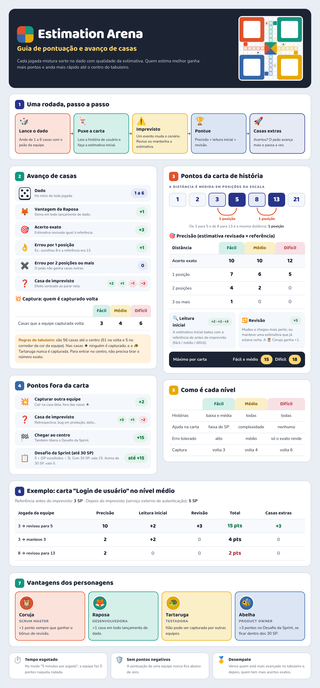

# Estimation Arena

Jogo para a disciplina Engenharia de Software.

Jogo de tabuleiro em 2D, no estilo Ludo, para treinar estimativas ágeis com Story Points. Até 4 equipes jogam no mesmo aparelho: lançam o dado, andam com o peão, estimam histórias de usuário, enfrentam imprevistos e disputam o ranking.

## Como jogar

1. Abra o `index.html` no navegador (ou publique com GitHub Pages).
2. Escolha a dificuldade, o modo do timer e o número de rodadas.
3. Ative de 1 a 4 equipes. Cada uma tem nome, integrantes, foto e um personagem.
4. Na sua vez, a equipe:
   - lança o dado e move o peão;
   - puxa uma carta de história e faz a estimativa inicial;
   - lê o imprevisto revelado e revisa a estimativa;
   - recebe os pontos e avança casas extras se acertou.
5. A partida termina quando o tempo acaba, quando todas as rodadas forem jogadas ou quando os jogadores encerram. O ranking final mostra o pódio e as estatísticas.

## Dificuldades

| Nível   | Histórias                     | Ajuda na carta                 | Pontuação               | Captura       |
|---------|-------------------------------|--------------------------------|-------------------------|---------------|
| Fácil   | baixa e média complexidade    | mostra a faixa de SP esperada  | tolerante               | volta 3 casas |
| Médio   | todas                         | mostra a complexidade          | padrão                  | volta 4 casas |
| Difícil | todas                         | complexidade oculta            | só o acerto exato rende | volta 6 casas |

## Personagens

| Personagem | Papel          | Vantagem                                   |
|------------|----------------|--------------------------------------------|
| 🦉 Coruja   | Scrum Master   | +1 ponto sempre que ganha o bônus de revisão |
| 🦊 Raposa   | Desenvolvedora | +1 casa em todo lançamento de dado         |
| 🐢 Tartaruga | Testadora     | não pode ser capturada                     |
| 🐝 Abelha   | Product Owner  | +3 pontos no Desafio da Sprint             |

Cada personagem só pode ser usado por uma equipe por partida.

## Pontuação

- **Precisão:** distância em posições da escala (1, 2, 3, 5, 8, 13, 21) entre a estimativa revisada e a referência.
- **Leitura inicial:** bônus quando a estimativa inicial bate com a referência antes do imprevisto.
- **Revisão:** +3 quando a equipe muda na direção certa ou mantém uma estimativa que já estava certa.
- **Movimento extra:** acerto exato dá +3 casas; uma posição de distância dá +1 casa.
- **Captura:** cair na casa de outra equipe (fora das casas ★) faz ela voltar e dá +2 pontos.
- **Centro do tabuleiro:** +15 pontos e o Desafio da Sprint (montar uma Sprint de até 30 SP, vale até 15 pontos).

## Tema diurno e noturno

O botão no topo da página alterna entre o modo diurno e o noturno. A escolha fica salva no navegador; sem escolha salva, o jogo segue o tema do sistema.

## Timer

O timer é de 5 minutos e pode valer para a partida inteira ou para cada jogada. Há botão de pausa.

## Ranking

- **Ao vivo:** placar ordenado durante a partida.
- **Final:** pódio e tabela com acertos exatos e distância média.
- **Geral:** as melhores equipes de todas as partidas, salvas no navegador do aparelho (`localStorage`).

## Tecnologia

Um único arquivo HTML com CSS e JavaScript puros, sem dependências nem etapa de build. As fontes vêm do Google Fonts.
